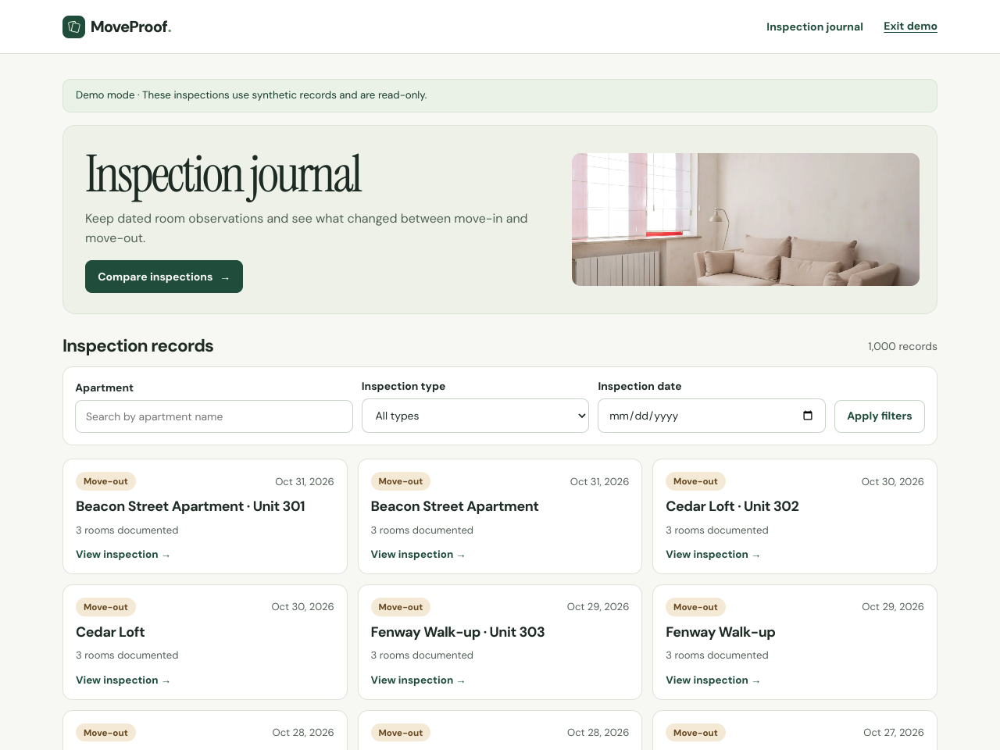

# MoveProof

**Project team** · Manoj Harridoss and Kavya Korem  
**Course** · [CS 5610 Web Development, Northeastern University](https://johnguerra.co/classes/webDevelopment_online_fall_2026/) · [Canvas](https://northeastern.instructure.com/courses/261032)  
**Assignment** · Project 3  
**Website** · [MoveProof on Vercel](https://moveproof-chi.vercel.app)

MoveProof helps student renters document apartment conditions and track shared deposit refunds. The Inspection Journal preserves dated room observations, photo links, and printable comparisons. The Deposit Tracker shows what each roommate contributed, what was deducted, and what refund they are still owed.



## Use the inspection journal

1. Select **Explore the demo** to browse 1,000 synthetic inspections, or create an account for your own journal.
2. Select **New inspection** and record the apartment name, date, inspection type, and each room’s condition. Add notes and up to three photo links per room if needed.
3. Filter the journal by apartment, inspection type, or date. Open an inspection to read, edit, or delete it.
4. Select **Compare inspections** and choose a move-in and a move-out record for the same apartment. The demo includes both inspections for **Beacon Street Apartment**. Select **Print comparison** to print the table or save a PDF from your browser.

## Use the deposit tracker

1. Open **Deposit tracker** and select **New settlement**, or use the read-only demo.
2. Enter an apartment name and each roommate’s contribution. Assign each agreed deduction to one roommate or split it equally.
3. Add dated refund payments and follow-up notes. Save the settlement to see per-roommate balances and refund history.
4. Filter the list by refund status. Open any of your settlements to edit or delete it.

## Build and run locally

Use Node.js 22 and a running MongoDB instance. Install the frontend and backend together from the repository root.

```bash
npm ci
cp .env.example .env
node -e "console.log(require('node:crypto').randomBytes(32).toString('hex'))"
```

Set `SESSION_SECRET` in `.env` to the generated value. The example URI points to a local MongoDB instance. For another instance, set `MONGODB_URI` to its connection string. Set `MONGODB_DB` to the database name.

```bash
npm run seed
npm run build
npm start
```

Open [http://localhost:3000](http://localhost:3000). The seed command can be rerun and creates 1,000 synthetic inspections and 1,000 synthetic settlements.

For development, use `npm run dev:api` and `npm run dev` in separate terminals. Open the URL Vite prints. Run `npm run lint` and `npm run format:check` to check source files.

## Architecture

Client-side React uses the Fetch API to call same-origin Express endpoints. The MongoDB Node.js driver handles inspection storage. Passport uses local authentication with bcrypt-hashed passwords and Mongo-backed sessions. Each inspection query is scoped to the signed-in owner. The read-only demo uses separate synthetic records.

### MongoDB collections

| Collection           | Contents                                                                                                                                                                   |
| -------------------- | -------------------------------------------------------------------------------------------------------------------------------------------------------------------------- |
| `inspections`        | Manoj’s Inspection Journal supports creating, viewing, editing, and deleting a renter’s records. The seed command adds 1,000 synthetic inspections for the read-only demo. |
| `depositSettlements` | Roommate contributions, agreed deductions, payment history, follow-up notes, and refund status. The seed command adds 1,000 synthetic settlements.                         |
| `users`              | Registered renter accounts and password hashes.                                                                                                                            |
| `sessions`           | Passport login sessions with an expiration time.                                                                                                                           |

The [design document](docs/DESIGN.md) describes both Project 3 workflows, personas, user stories, and mockups.

## Production deployment

Vercel builds the React frontend from the repository root. The `vercel.json` configuration forwards `/api` requests to the Express function and serves direct links under `/journal` and `/settlements` through React Router.

Set `MONGODB_URI` and `SESSION_SECRET` as sensitive environment variables in the Vercel project. `MONGODB_DB` defaults to `moveproof`. The production connection uses a database user scoped to that database in the MoveProof Atlas project. For local setup, use `.env.example` and keep actual credentials in the ignored `.env` file.

After redeploying with the environment variables, check `/api/health` for `{"ok":true}`. Open **Explore the demo**, then **Deposit tracker**, to load both sets of synthetic records into the deployed database. To verify writes, create an account and save an inspection and a settlement. Reload each page to check that the records persist.

## Assets and license

Source code is covered by the [MIT License](LICENSE). The interface uses a [living-room photo by Max Vakhtbovych](https://www.pexels.com/photo/couch-in-room-8092177/) under the [Pexels license](https://www.pexels.com/license/). The fonts have separate [DM Sans](frontend/public/fonts/OFL-DM-Sans.txt) and [Instrument Serif](frontend/public/fonts/OFL-Instrument-Serif.txt) licenses.

## AI disclosure

AI assistance was used for research, brainstorming, and project planning. All implementation, testing, and documentation were completed independently by the team.

