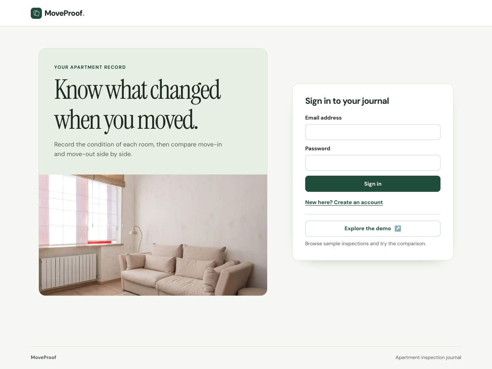
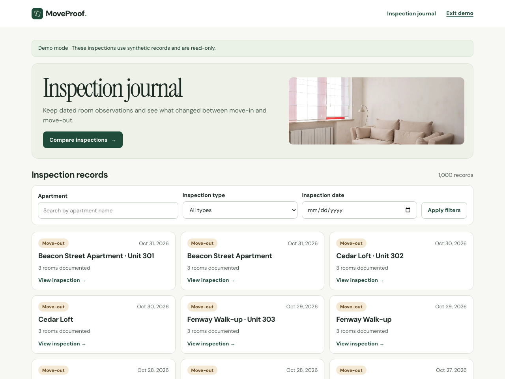
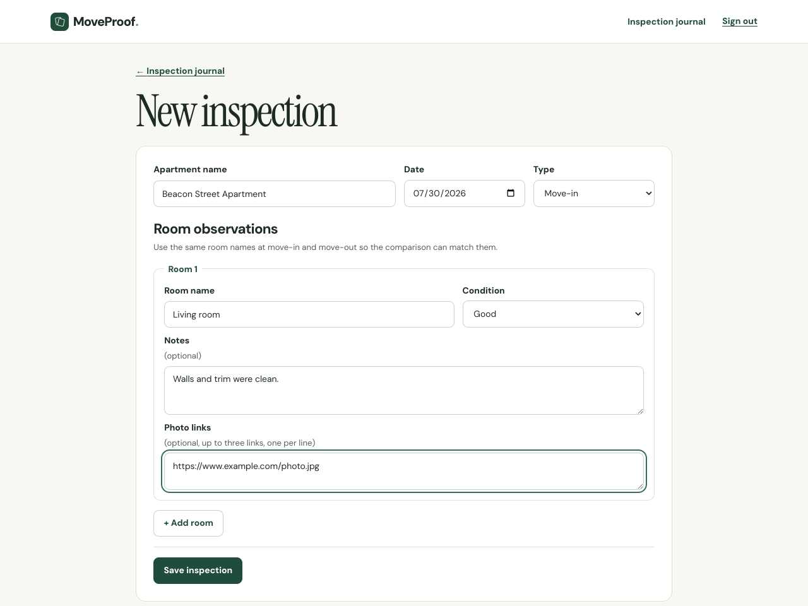
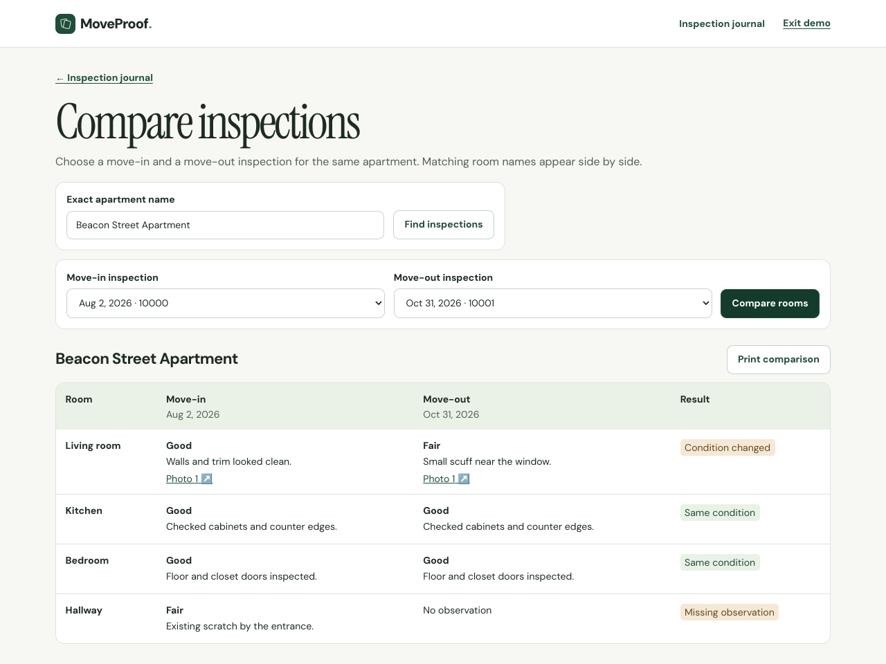
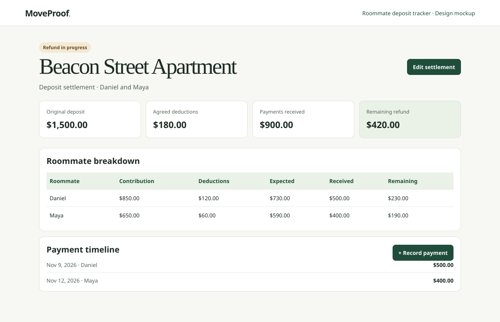
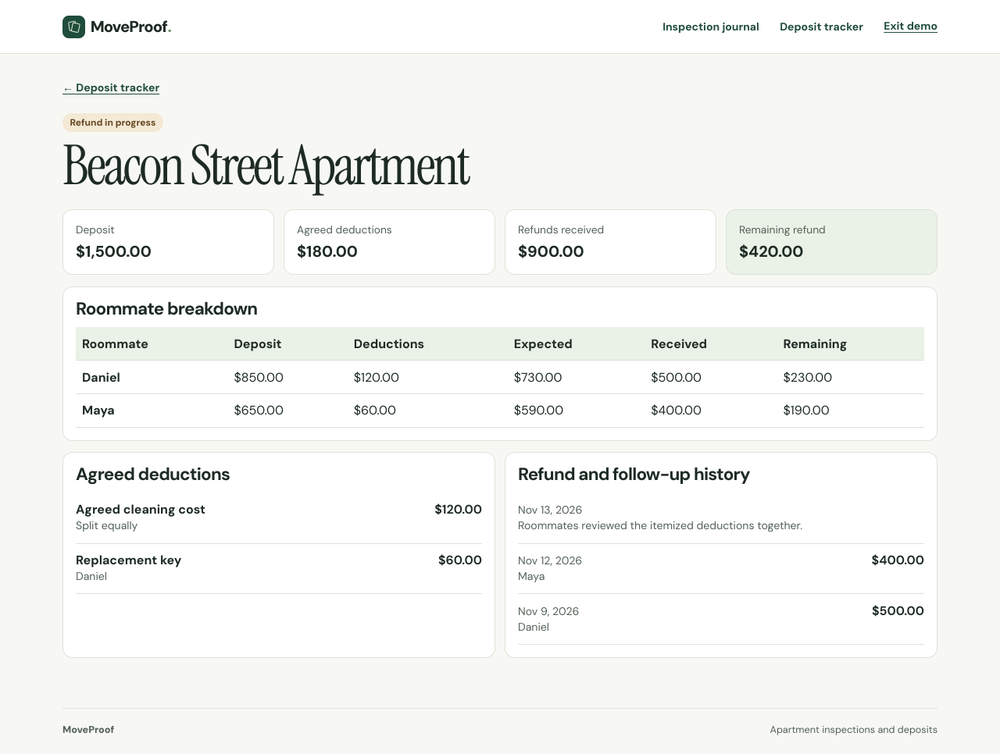

# MoveProof · Project 3 design

Manoj Harridoss and Kavya Korem · Northeastern University CS 5610

## Project description

Student renters often have scattered room photos and notes when they move into or leave an apartment. They may also have to track a shared deposit while roommates move out on different dates. MoveProof provides an **Inspection Journal** for apartment conditions and a **Roommate Deposit Tracker** for agreed deductions and refunds. Renters use the journal to keep room-by-room records and compare two inspections. They use the tracker to record what each roommate contributed, how agreed deductions are allocated, and what each roommate has received.

## Personas

| Persona                     | Situation                                                                                                           | What they need                                                                     |
| --------------------------- | ------------------------------------------------------------------------------------------------------------------- | ---------------------------------------------------------------------------------- |
| Maya Chen, student renter   | Maya moves into a shared apartment and wants a record of the condition before unpacking.                            | A dated record by room, with a comparison she can print when she moves out.        |
| Daniel Ortiz, co-op student | Daniel is moving for a co-op. Two roommates paid different shares of a deposit, and refunds arrive in installments. | One view of agreed deductions, each roommate’s payments, and the expected balance. |

## User stories

### Manoj · Inspection Journal

- As Maya, I want to create, edit, and delete an inspection with an apartment name, date, type, and room observations so I can maintain a dependable record.
- As Maya, I want to browse my inspections and filter them by apartment, inspection type, or date so I can find an earlier observation.
- As Maya, I want to pick a move-in and move-out inspection for the same apartment and compare the room conditions so I can review changed conditions and missing observations.
- As Maya, I want to print the side-by-side comparison so I can reference it during a move-out conversation.

### Kavya · Roommate Deposit Tracker

- As Daniel, I want to create, edit, and delete a settlement with an apartment name, roommate contributions, and agreed deductions so I can keep an accurate account of the deposit.
- As Daniel, I want to assign a deduction to one roommate or divide it equally so each person can see their expected refund.
- As Daniel, I want to record, edit, or remove dated payments and follow-up notes so I can see what each roommate has received.
- As Daniel, I want to filter settlements by refund status so I can quickly see which deposits still have an outstanding balance.

## Design mockups

### Sign-in and demo entry

A renter can open the synthetic demo, sign in, or create an account from one screen.

### Inspection journal

Filters and inspection cards give renters an overview. From the journal, they can open a record, add an inspection, or start a comparison.

### Inspection editor

An inspection has room observations with consistent room names, a condition, optional notes, and optional photo links.

### Inspection comparison

The two dates remain visible above the room observations. Changes and absent observations receive distinct text labels. Print styling keeps the heading and table.

### Roommate Deposit Tracker concept

The settlement view shows the total deposit, agreed deductions, payments received, and the balance for each roommate. The payment timeline records the date, recipient, and amount of each installment.

### Implemented settlement detail

The demo settlement includes a shared deduction, an individual deduction, and partial refund payments. Each roommate’s balance is calculated independently using integer cents.

## Data and responsibilities

| Workflow                         | Full-stack scope                                                                                                        | MongoDB collection   |
| -------------------------------- | ----------------------------------------------------------------------------------------------------------------------- | -------------------- |
| Inspection Journal · Manoj       | React forms, journal and comparison, Express validation and endpoints, ownership-scoped CRUD, synthetic inspection data | `inspections`        |
| Roommate Deposit Tracker · Kavya | React settlement forms and ledger, Express validation and endpoints, ownership-scoped CRUD, synthetic settlement data   | `depositSettlements` |

The workflows each keep their own apartment label and own records. Express provides shared authentication, and each feature uses the authenticated user ID to scope queries. A settlement calculates its own balances from contribution, allocated deduction, and payment amounts recorded within that settlement. The journal computes changes from the two selected inspection records.

## Implementation details

The project uses Node.js, Express with ES modules, client-rendered React with Hooks, the native MongoDB driver, and Passport sessions. React components have their own files, and styled components import their corresponding CSS.
